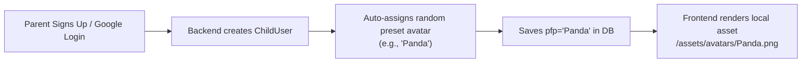
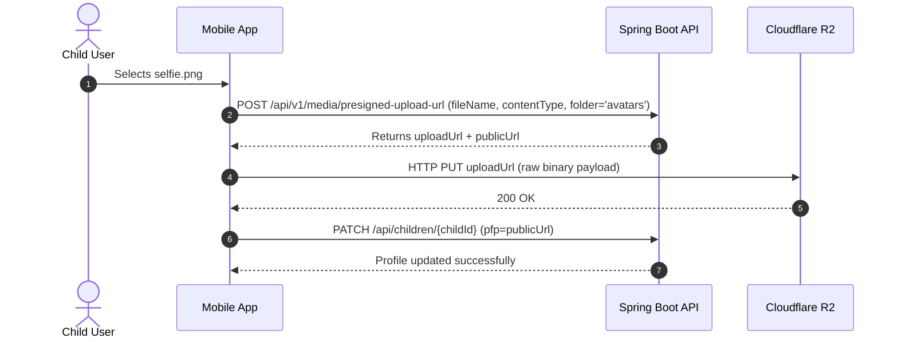
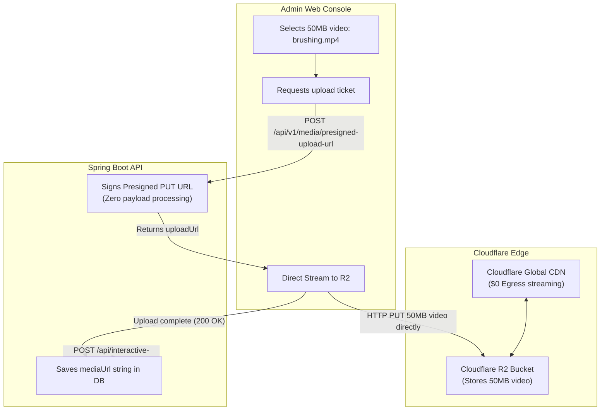

# Media Pipeline: Scenarios & Integration Examples

This document walks through practical, real-world scenarios illustrating how frontend applications and backend services interact with **Cloudflare R2** and **Sensei Backend APIs**.

---

## 📑 Index of Scenarios

1. [Scene 1: New Child Signup & Login (Auto-Avatar Assignment)](#scene-1-new-child-signup--login-auto-avatar-assignment)
2. [Scene 2: Uploading a Custom Profile Picture (Direct-to-R2)](#scene-2-uploading-a-custom-profile-picture-direct-to-r2)
3. [Scene 3: Replacing an Existing Custom Photo (Auto-Cleanup)](#scene-3-replacing-an-existing-custom-photo-auto-cleanup)
4. [Scene 4: Removing Custom Photo (Reverting to Preset Avatar)](#scene-4-removing-custom-photo-reverting-to-preset-avatar)
5. [Scene 5: Admin Creating a Subject with an Icon](#scene-5-admin-creating-a-subject-with-an-icon)
6. [Scene 6: Admin Uploading a 50MB Process Video](#scene-6-admin-uploading-a-50mb-process-video)
7. [Fetching, Edge Caching & Delivery Architecture](#7-fetching-edge-caching--delivery-architecture)
8. [Frontend Rendering Guide for All Asset Types](#8-frontend-rendering-guide-for-all-asset-types)
9. [Summary Architecture Matrix](#9-summary-architecture-matrix)

---

## Scene 1: New Child Signup & Login (Auto-Avatar Assignment)

### Context
A parent signs up using Google OAuth or registers an account. An empty child profile is automatically initialized for the parent. The child has not uploaded any custom photo.



### Flow:
1. **Parent Authentication:**
   `POST /api/auth/google?client=app`
2. **Backend Execution:**
   In `ChildUserService`, the backend randomly selects one from the 6 preset animal avatars:
   - `Blue Bird`
   - `Fox`
   - `Panda`
   - `Pink Kitten`
   - `Puppy`
   - `Turtle`
3. **Database State:**
   - Table: `child_user`
   - Column: `pfp = "Panda"`
4. **Result:**
   **$0 storage cost.** No files are sent to Cloudflare R2; the frontend loads the image from its local app bundle.

---

## Scene 2: Uploading a Custom Profile Picture (Direct-to-R2)

### Context
The child wants a personalized avatar and chooses a selfie (`selfie.png`) from the device gallery.



### Step 2A: Request Upload Ticket
```http
POST /api/v1/media/presigned-upload-url
Authorization: Bearer <jwt_access_token>
Content-Type: application/json

{
  "fileName": "selfie.png",
  "contentType": "image/png",
  "folder": "avatars"
}
```

**Response:**
```json
{
  "status": "SUCCESS",
  "data": {
    "uploadUrl": "https://<account_id>.r2.cloudflarestorage.com/sensei-media/avatars/2026/11/9f8c1e2a-4d5e.png?X-Amz-Signature=...",
    "publicUrl": "https://media.yourdomain.com/avatars/2026/11/9f8c1e2a-4d5e.png",
    "fileKey": "avatars/2026/11/9f8c1e2a-4d5e.png",
    "expiresInSeconds": 600
  }
}
```

### Step 2B: Direct HTTP PUT to Cloudflare R2
```javascript
await fetch(uploadUrl, {
  method: 'PUT',
  headers: { 'Content-Type': 'image/png' },
  body: fileObject
});
```
*(Backend CPU & RAM usage: 0%)*

### Step 2C: Save URL to Child Profile
```http
PATCH /api/children/c80794f1-6327-475c-8335-f916d68e405f
Authorization: Bearer <jwt_access_token>
Content-Type: application/json

{
  "pfp": "https://media.yourdomain.com/avatars/2026/11/9f8c1e2a-4d5e.png"
}
```

> [!NOTE]
> **Enterprise URL Normalization:** The client can send either the full CDN `publicUrl` or the relative `fileKey` (`"avatars/2026/11/9f8c1e2a-4d5e.png"`). The backend automatically persists the domain-agnostic relative key in the database and dynamically resolves it to the full CDN URL when queried.


---

## Scene 3: Replacing an Existing Custom Photo (Auto-Cleanup)

### Context
Two weeks later, the child chooses a new picture (`new_avatar.jpg`).

1. **Upload:** App gets a new presigned URL and uploads `new_avatar.jpg` to R2 (`https://media.yourdomain.com/avatars/2026/11/3b2c1a4e.jpg`).
2. **Update Request:**
   ```http
   PATCH /api/children/c80794f1-6327-475c-8335-f916d68e405f
   Content-Type: application/json

   {
     "pfp": "https://media.yourdomain.com/avatars/2026/11/3b2c1a4e.jpg"
   }
   ```
3. **Automatic Cleanup in Backend:**
   `ChildUserService` detects that the previous `pfp` was a custom R2 URL (`9f8c1e2a-4d5e.png`) and automatically triggers `MediaStorageService.deleteFile(...)`.
4. **Result:**
   The old image is purged from R2 storage immediately, preventing orphaned file accumulation.

---

## Scene 4: Removing Custom Photo (Reverting to Preset Avatar)

### Context
The child taps **"Remove Custom Photo"** to go back to an animal avatar.

### Endpoint:
```http
DELETE /api/children/c80794f1-6327-475c-8335-f916d68e405f/pfp
Authorization: Bearer <jwt_access_token>
```
*(Alternatively: `PATCH /api/children/{id}` with `{ "pfp": "" }`)*

### Backend Action:
1. Deletes `https://media.yourdomain.com/avatars/2026/11/3b2c1a4e.jpg` from Cloudflare R2.
2. Selects a fresh random animal avatar (e.g., `"Fox"`).
3. Updates DB: `child_user.pfp = "Fox"`.

### Response:
```json
{
  "status": "SUCCESS",
  "data": {
    "childId": "c80794f1-6327-475c-8335-f916d68e405f",
    "childName": "Rohan",
    "pfp": "Fox"
  }
}
```

---

## Scene 5: Admin Creating a Subject with an Icon

### Context
Admin creates a new subject called "Astronomy" with an icon `telescope.svg`.

1. **Request Presigned Upload URL:**
   ```json
   POST /api/v1/media/presigned-upload-url
   {
     "fileName": "telescope.svg",
     "contentType": "image/svg+xml",
     "folder": "subjects"
   }
   ```
   *Returns:* `publicUrl = "https://media.yourdomain.com/subjects/2026/11/telescope.svg"`
2. **Upload directly to R2:** `PUT` to `uploadUrl`.
3. **Create Subject:**
   ```http
   POST /api/subjects
   Authorization: Bearer <admin_jwt>
   Content-Type: application/json

   {
     "name": "Astronomy",
     "description": "Explore stars, planets, and galaxies",
     "iconUrl": "https://media.yourdomain.com/subjects/2026/11/telescope.svg"
   }
   ```
4. **Student App Fetches Subjects:**
   `GET /api/subjects` returns `{ "name": "Astronomy", "iconUrl": "https://media.yourdomain.com/subjects/2026/11/telescope.svg" }`.

---

## Scene 6: Admin Uploading a 50MB Process Video

### Context
Admin attaches an instructional 50MB step video `brushing_circular_motion.mp4` to an interactive process step.



1. **Presigned URL:**
   - `POST /api/v1/media/presigned-upload-url` with `folder: "interactive-processes"` and `contentType: "video/mp4"`.
2. **Direct Upload:**
   - Browser sends the 50MB binary directly to Cloudflare R2.
   - **Spring Boot backend bandwidth and memory consumed: 0 MB.**
3. **Save Entity:**
   ```http
   POST /api/interactive-processes
   {
     "stepOrder": 2,
     "senseiMessage": "Brush gently in small circles.",
     "mediaUrl": "https://media.yourdomain.com/interactive-processes/2026/11/brushing.mp4"
   }
   ```
4. **Delivery:**
   When children watch the video, Cloudflare CDN serves it worldwide with **$0 egress fees**.

---

## 7. Fetching, Edge Caching & Delivery Architecture

When a user opens any screen in the mobile or web app, **the Spring Boot server never touches or streams media bytes**.

```
[ Step 1: Fetch Metadata JSON ]
Frontend Client  ────────► GET /api/subjects ────────► Spring Boot API
Frontend Client  ◄─────── Returns JSON with URLs ───── Spring Boot API
                          (e.g., iconUrl: "https://media.yourdomain.com/subjects/uuid.svg")

[ Step 2: Stream Media from Closest CDN Node ]
Frontend Client  ────────► GET https://media.yourdomain.com/... ────────► Cloudflare Edge CDN
Frontend Client  ◄─────── High-speed cached image/video bytes ───────── Cloudflare Edge CDN
                          (0% Spring Boot server load | $0 Egress bandwidth)
```

### Key Principles:
1. **Public vs. Protected Media:**
   - Public assets (Subject icons, Activity covers/videos, Process step GIFs, Avatars) are served through Cloudflare's Custom Domain. No authorization headers are needed for GET requests, enabling browser-level and edge-level HTTP caching.
   - Only writing/uploading requires JWT authentication.
2. **Global Edge Caching:**
   - Cloudflare caches files at edge locations closest to the user (under 20ms response time).
   - If an asset is requested for the first time in a region (Cache Miss), Cloudflare fetches it once from the R2 bucket, caches it, and serves subsequent requests from cache (Cache Hit).
3. **Zero Stale Cache:**
   - Every uploaded file has a unique UUID filename (e.g., `media/2026/11/uuid.png`). If an admin or user replaces a file, a new URL is generated, so you never encounter stale cache issues.

---

## 8. Frontend Rendering Guide for All Asset Types

### 8A. Subject Icons (`SubjectResponseDTO.iconUrl`)

#### API Payload:
```json
{
  "id": "334e17ae-b88f-49e4-8287-26073668dc22",
  "name": "Astronomy",
  "iconUrl": "https://media.yourdomain.com/subjects/2026/11/telescope.svg"
}
```

#### React / Web:
```jsx
export function SubjectCard({ subject }) {
  return (
    <div className="subject-card">
       {
          e.currentTarget.src = '/assets/default_subject.png';
        }}
        className="w-12 h-12 object-contain"
      />
      <h3>{subject.name}</h3>
    </div>
  );
}
```

#### Flutter / Mobile:
```dart
Widget buildSubjectIcon(String? iconUrl) {
  return CachedNetworkImage(
    imageUrl: iconUrl ?? '',
    width: 48,
    height: 48,
    fit: BoxFit.contain,
    placeholder: (context, url) => const SizedBox(
      width: 48,
      height: 48,
      child: CircularProgressIndicator(strokeWidth: 2),
    ),
    errorWidget: (context, url, error) => Image.asset(
      'assets/default_subject.png',
      width: 48,
      height: 48,
    ),
  );
}
```

---

### 8B. Activity Covers & Explainer Videos (`InteractiveActivity`)

#### API Payload:
```json
{
  "id": "activity-uuid",
  "title": "Dental Hygiene Basics",
  "coverImage": "https://media.yourdomain.com/activities/covers/teeth.jpg",
  "referenceVideo": "https://media.yourdomain.com/activities/videos/brushing_intro.mp4"
}
```

#### React / Web Video Player:
```jsx
export function ActivityMediaViewer({ coverImage, referenceVideo, title }) {
  return (
    <div className="activity-media-container rounded-2xl overflow-hidden shadow-lg">
      <video
        controls
        poster={coverImage}
        preload="metadata"
        playsInline
        className="w-full aspect-video rounded-2xl bg-black"
      >
        <source src={referenceVideo} type="video/mp4" />
        Your device does not support playing this video.
      </video>
    </div>
  );
}
```
*Note:* `preload="metadata"` downloads only the duration and first frame metadata until the user taps play, saving bandwidth.

---

### 8C. Interactive Process Steps (Step Animations & GIFs)

#### API Payload:
```json
{
  "stepOrder": 1,
  "senseiMessage": "Hold your toothbrush at a 45-degree angle.",
  "mediaUrl": "https://media.yourdomain.com/interactive-processes/brush_45.gif"
}
```

#### React / Web Component:
```jsx
export function ProcessStepVisual({ mediaUrl, message }) {
  const isVideo = mediaUrl?.toLowerCase().endsWith(".mp4") || mediaUrl?.toLowerCase().endsWith(".webm");

  return (
    <div className="step-visual-card text-center">
      {isVideo ? (
        <video
          src={mediaUrl}
          autoPlay
          loop
          muted
          playsInline
          className="rounded-xl mx-auto max-h-64"
        />
      ) : (
        
      )}
      <p className="mt-4 text-lg font-medium">{message}</p>
    </div>
  );
}
```

---

### 8D. Child Profile Pictures (`ChildUser.pfp`)

Handles both preset animal names (`"Panda"`, `"Fox"`) and custom uploaded Cloudflare R2 URLs seamlessly:

#### React / Web Component:
```jsx
export function ChildAvatar({ pfp, size = 48 }) {
  // 1. If pfp starts with "http", it is a custom uploaded photo from Cloudflare R2
  if (pfp && pfp.startsWith("http")) {
    return (
       {
          e.currentTarget.src = "/assets/avatars/Fox.png";
        }}
      />
    );
  }

  // 2. Otherwise, it is an animal preset name -> render from local app bundle
  const avatarName = pfp || "Fox";
  return (
    
  );
}
```

#### Flutter / Mobile Widget:
```dart
Widget buildChildAvatar(String? pfp, {double radius = 24.0}) {
  if (pfp != null && pfp.startsWith("http")) {
    return CircleAvatar(
      radius: radius,
      backgroundImage: CachedNetworkImageProvider(pfp),
    );
  }

  final avatarName = pfp ?? "Fox";
  return CircleAvatar(
    radius: radius,
    backgroundImage: AssetImage('assets/avatars/$avatarName.png'),
  );
}
```

---

### 8E. Performance & Rendering Best Practices

| Practice | Implementation | Benefit |
| :--- | :--- | :--- |
| **Lazy Loading** | `loading="lazy"` on images | Images outside screen viewport are not downloaded until scrolled into view. |
| **Disk Caching (Mobile)** | `CachedNetworkImage` (Flutter) / `FastImage` (React Native) | Assets stored on local device disk; zero repeat network calls when navigating tabs. |
| **Video Preloading** | `preload="metadata"` | Only loads video duration/dimensions rather than the full 50MB file on screen load. |
| **Graceful Fallbacks** | `onError` handler | If a user goes offline or a link is unreachable, displays default icon rather than broken image box. |

---

## 9. Summary Architecture Matrix

| Scenario | `pfp` / `mediaUrl` Value | Stored in R2? | Storage / Bandwidth Cost | Frontend Rendering |
| :--- | :--- | :--- | :--- | :--- |
| **New Child** | `"Panda"` (Preset name) | No | **$0** | Local asset `/assets/avatars/Panda.png` |
| **Custom Photo** | `https://media.../avatars/uuid.png` | Yes | Standard R2 storage | Network image streamed from Cloudflare CDN |
| **Photo Removed**| `"Fox"` (Preset name) | No (Old deleted) | **$0** (Old storage freed) | Reverts immediately to local preset asset |
| **Subject Icon** | `https://media.../subjects/uuid.svg`| Yes | Standard R2 storage | Global CDN cache with $0 egress |
| **Process Video**| `https://media.../processes/uuid.mp4`| Yes | Standard R2 storage | Edge streaming with $0 egress |


