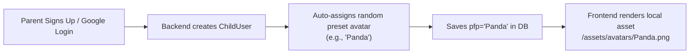
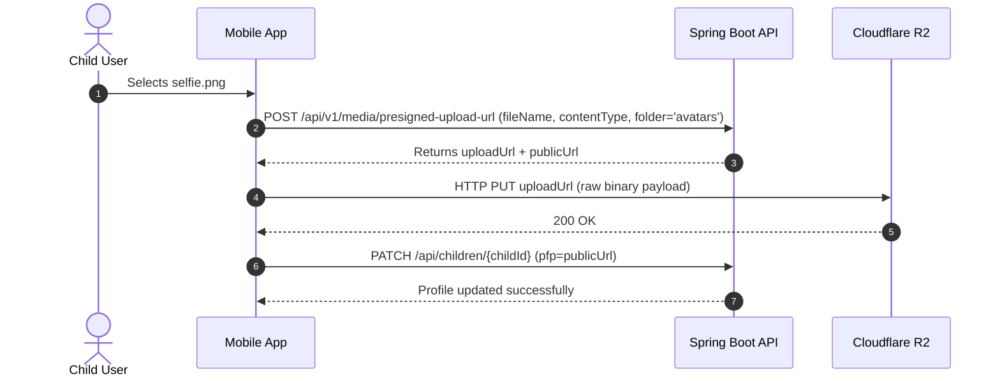
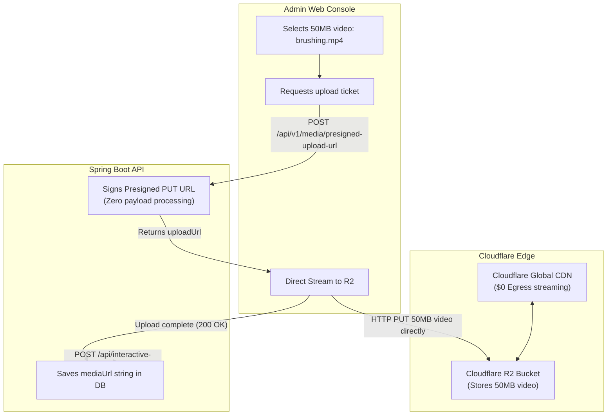

# Media Pipeline: Scenarios & Integration Examples

This document walks through practical, real-world scenarios illustrating how frontend applications and backend services interact with **Cloudflare R2** and **Sensei Backend APIs**.

---

## 📑 Index of Scenarios

1. [Scene 1: New Child Signup & Login (Auto-Avatar Assignment)](#scene-1-new-child-signup--login-auto-avatar-assignment)
2. [Scene 2: Uploading a Custom Profile Picture (Direct-to-R2)](#scene-2-uploading-a-custom-profile-picture-direct-to-r2)
3. [Scene 3: Replacing an Existing Custom Photo (Auto-Cleanup)](#scene-3-replacing-an-existing-custom-photo-auto-cleanup)
4. [Scene 4: Removing Custom Photo (Reverting to Preset Avatar)](#scene-4-removing-custom-photo-reverting-to-preset-avatar)
5. [Scene 5: Admin Creating a Subject with an Icon](#scene-5-admin-creating-a-subject-with-an-icon)
6. [Scene 6: Admin Uploading a 50MB Process Video](#scene-6-admin-uploading-a-50mb-process-video)
7. [Frontend Display & Rendering Guide](#frontend-display--rendering-guide)
8. [Summary Architecture Matrix](#summary-architecture-matrix)

---

## Scene 1: New Child Signup & Login (Auto-Avatar Assignment)

### Context
A parent signs up using Google OAuth or registers an account. An empty child profile is automatically initialized for the parent. The child has not uploaded any custom photo.



### Flow:
1. **Parent Authentication:**
   `POST /api/auth/google?client=app`
2. **Backend Execution:**
   In `ChildUserService`, the backend randomly selects one from the 6 preset animal avatars:
   - `Blue Bird`
   - `Fox`
   - `Panda`
   - `Pink Kitten`
   - `Puppy`
   - `Turtle`
3. **Database State:**
   - Table: `child_user`
   - Column: `pfp = "Panda"`
4. **Result:**
   **$0 storage cost.** No files are sent to Cloudflare R2; the frontend loads the image from its local app bundle.

---

## Scene 2: Uploading a Custom Profile Picture (Direct-to-R2)

### Context
The child wants a personalized avatar and chooses a selfie (`selfie.png`) from the device gallery.



### Step 2A: Request Upload Ticket
```http
POST /api/v1/media/presigned-upload-url
Authorization: Bearer <jwt_access_token>
Content-Type: application/json

{
  "fileName": "selfie.png",
  "contentType": "image/png",
  "folder": "avatars"
}
```

**Response:**
```json
{
  "status": "SUCCESS",
  "data": {
    "uploadUrl": "https://<account_id>.r2.cloudflarestorage.com/sensei-media/avatars/2026/11/9f8c1e2a-4d5e.png?X-Amz-Signature=...",
    "publicUrl": "https://media.yourdomain.com/avatars/2026/11/9f8c1e2a-4d5e.png",
    "fileKey": "avatars/2026/11/9f8c1e2a-4d5e.png",
    "expiresInSeconds": 600
  }
}
```

### Step 2B: Direct HTTP PUT to Cloudflare R2
```javascript
await fetch(uploadUrl, {
  method: 'PUT',
  headers: { 'Content-Type': 'image/png' },
  body: fileObject
});
```
*(Backend CPU & RAM usage: 0%)*

### Step 2C: Save URL to Child Profile
```http
PATCH /api/children/c80794f1-6327-475c-8335-f916d68e405f
Authorization: Bearer <jwt_access_token>
Content-Type: application/json

{
  "pfp": "https://media.yourdomain.com/avatars/2026/11/9f8c1e2a-4d5e.png"
}
```

---

## Scene 3: Replacing an Existing Custom Photo (Auto-Cleanup)

### Context
Two weeks later, the child chooses a new picture (`new_avatar.jpg`).

1. **Upload:** App gets a new presigned URL and uploads `new_avatar.jpg` to R2 (`https://media.yourdomain.com/avatars/2026/11/3b2c1a4e.jpg`).
2. **Update Request:**
   ```http
   PATCH /api/children/c80794f1-6327-475c-8335-f916d68e405f
   Content-Type: application/json

   {
     "pfp": "https://media.yourdomain.com/avatars/2026/11/3b2c1a4e.jpg"
   }
   ```
3. **Automatic Cleanup in Backend:**
   `ChildUserService` detects that the previous `pfp` was a custom R2 URL (`9f8c1e2a-4d5e.png`) and automatically triggers `MediaStorageService.deleteFile(...)`.
4. **Result:**
   The old image is purged from R2 storage immediately, preventing orphaned file accumulation.

---

## Scene 4: Removing Custom Photo (Reverting to Preset Avatar)

### Context
The child taps **"Remove Custom Photo"** to go back to an animal avatar.

### Endpoint:
```http
DELETE /api/children/c80794f1-6327-475c-8335-f916d68e405f/pfp
Authorization: Bearer <jwt_access_token>
```
*(Alternatively: `PATCH /api/children/{id}` with `{ "pfp": "" }`)*

### Backend Action:
1. Deletes `https://media.yourdomain.com/avatars/2026/11/3b2c1a4e.jpg` from Cloudflare R2.
2. Selects a fresh random animal avatar (e.g., `"Fox"`).
3. Updates DB: `child_user.pfp = "Fox"`.

### Response:
```json
{
  "status": "SUCCESS",
  "data": {
    "childId": "c80794f1-6327-475c-8335-f916d68e405f",
    "childName": "Rohan",
    "pfp": "Fox"
  }
}
```

---

## Scene 5: Admin Creating a Subject with an Icon

### Context
Admin creates a new subject called "Astronomy" with an icon `telescope.svg`.

1. **Request Presigned Upload URL:**
   ```json
   POST /api/v1/media/presigned-upload-url
   {
     "fileName": "telescope.svg",
     "contentType": "image/svg+xml",
     "folder": "subjects"
   }
   ```
   *Returns:* `publicUrl = "https://media.yourdomain.com/subjects/2026/11/telescope.svg"`
2. **Upload directly to R2:** `PUT` to `uploadUrl`.
3. **Create Subject:**
   ```http
   POST /api/subjects
   Authorization: Bearer <admin_jwt>
   Content-Type: application/json

   {
     "name": "Astronomy",
     "description": "Explore stars, planets, and galaxies",
     "iconUrl": "https://media.yourdomain.com/subjects/2026/11/telescope.svg"
   }
   ```
4. **Student App Fetches Subjects:**
   `GET /api/subjects` returns `{ "name": "Astronomy", "iconUrl": "https://media.yourdomain.com/subjects/2026/11/telescope.svg" }`.

---

## Scene 6: Admin Uploading a 50MB Process Video

### Context
Admin attaches an instructional 50MB step video `brushing_circular_motion.mp4` to an interactive process step.



1. **Presigned URL:**
   - `POST /api/v1/media/presigned-upload-url` with `folder: "interactive-processes"` and `contentType: "video/mp4"`.
2. **Direct Upload:**
   - Browser sends the 50MB binary directly to Cloudflare R2.
   - **Spring Boot backend bandwidth and memory consumed: 0 MB.**
3. **Save Entity:**
   ```http
   POST /api/interactive-processes
   {
     "stepOrder": 2,
     "senseiMessage": "Brush gently in small circles.",
     "mediaUrl": "https://media.yourdomain.com/interactive-processes/2026/11/brushing.mp4"
   }
   ```
4. **Delivery:**
   When children watch the video, Cloudflare CDN serves it worldwide with **$0 egress fees**.

---

## Frontend Display & Rendering Guide

Frontend clients (React, Angular, Flutter, Android, iOS) should implement avatar rendering using this uniform pattern:

### React / Next.js Component
```jsx
export function UserAvatar({ pfp, size = 48 }) {
  // 1. If pfp is a full URL, it is a custom uploaded photo from Cloudflare R2
  if (pfp && pfp.startsWith("http")) {
    return (
      
    );
  }

  // 2. Otherwise, it is an animal preset name -> render from local assets
  const avatarName = pfp || "Fox";
  return (
    
  );
}
```

### Flutter / Mobile Widget
```dart
Widget buildAvatar(String? pfp, {double radius = 24.0}) {
  if (pfp != null && pfp.startsWith("http")) {
    return CircleAvatar(
      radius: radius,
      backgroundImage: NetworkImage(pfp),
    );
  }

  final avatarName = pfp ?? "Fox";
  return CircleAvatar(
    radius: radius,
    backgroundImage: AssetImage('assets/avatars/$avatarName.png'),
  );
}
```

---

## Summary Architecture Matrix

| Scenario | `pfp` / `mediaUrl` Value | Stored in R2? | Storage / Bandwidth Cost | Frontend Rendering |
| :--- | :--- | :--- | :--- | :--- |
| **New Child** | `"Panda"` (Preset name) | No | **$0** | Local asset `/assets/avatars/Panda.png` |
| **Custom Photo** | `https://media.../avatars/uuid.png` | Yes | Standard R2 storage | Network image streamed from Cloudflare CDN |
| **Photo Removed**| `"Fox"` (Preset name) | No (Old deleted) | **$0** (Old storage freed) | Reverts immediately to local preset asset |
| **Subject Icon** | `https://media.../subjects/uuid.svg`| Yes | Standard R2 storage | Global CDN cache with $0 egress |
| **Process Video**| `https://media.../processes/uuid.mp4`| Yes | Standard R2 storage | Edge streaming with $0 egress |

