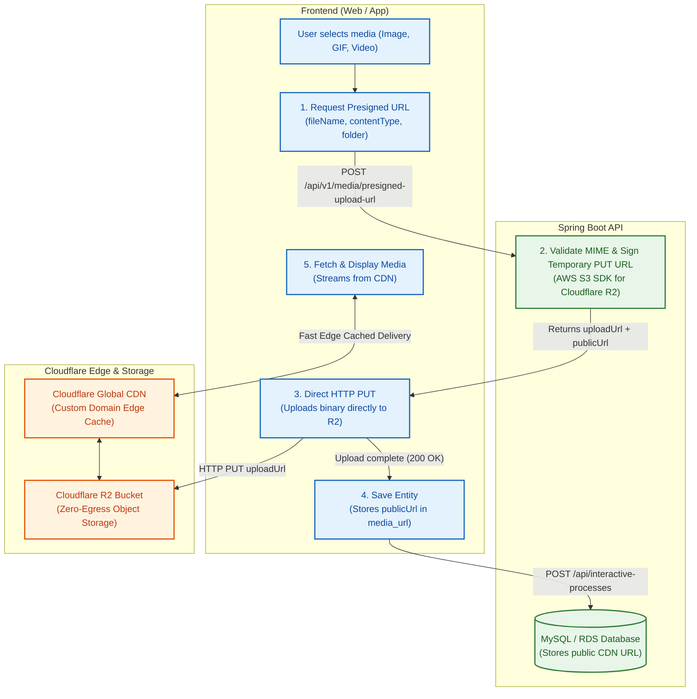

# Media Storage & Cloudflare R2 Pipeline

This document serves as the **Technical Specification & Integration Guide** for storing and serving pictures, GIFs, and videos via **Cloudflare R2** object storage with edge caching.

---

## 1. Architecture Overview & Best Practice

In high-performance systems, media files (especially large pictures, GIFs, and videos) should **never be uploaded through the application backend**. Passing binary payloads through Spring Boot:
- Slashes throughput and saturates server thread pools.
- Spikes backend RAM and CPU usage.
- Incurs unnecessary compute and bandwidth overhead.

### Industry-Standard Direct-to-Storage Architecture

We utilize **Direct-to-Storage via S3 Presigned URLs** backed by Cloudflare R2:



---

### Why Cloudflare R2?
1. **Zero Egress Fees:** Unlike AWS S3 where outbound data transfers incur significant recurring costs, Cloudflare R2 has **\$0 egress bandwidth costs**.
2. **S3 Compatibility:** Uses standard AWS S3 SDK v2 (`software.amazon.awssdk:s3`).
3. **Edge Caching via Custom Domain:** Attaching a custom domain (e.g. `media.yourdomain.com`) routes traffic through Cloudflare's global CDN cache automatically.

---

## 2. Backend Configuration & Environment Variables

Add the following credentials to `.env`:

```env
# Cloudflare R2 Storage (Media: pics, gifs, vids)
CLOUDFLARE_R2_ACCOUNT_ID=your_cloudflare_account_id_here
CLOUDFLARE_R2_ACCESS_KEY=your_r2_access_key_id_here
CLOUDFLARE_R2_SECRET_KEY=your_r2_secret_access_key_here
CLOUDFLARE_R2_BUCKET_NAME=sensei-media
CLOUDFLARE_R2_PUBLIC_DOMAIN=https://media.yourdomain.com
CLOUDFLARE_R2_EXPIRATION_MINUTES=10
```

### Path-Style S3 Configuration
Cloudflare R2 endpoints follow the format:
`https://<ACCOUNT_ID>.r2.cloudflarestorage.com/<BUCKET_NAME>/<OBJECT_KEY>`

In `CloudflareR2Config.java`, path-style access is enabled:
```java
S3Configuration.builder().pathStyleAccessEnabled(true).build();
```
This ensures URL signing aligns with Cloudflare without SSL wildcard certificate issues.

---

## 3. API Specification

### 3A. Request Presigned Upload URL

* **Endpoint:** `POST /api/v1/media/presigned-upload-url`
* **Headers:**
  - `Content-Type: application/json`
  - `Authorization: Bearer <jwt_access_token>`
* **Request Body:**
  ```json
  {
    "fileName": "interactive-step-demo.mp4",
    "contentType": "video/mp4",
    "folder": "interactive-processes"
  }
  ```

#### Validation Rules:
* `fileName`: Non-blank string.
* `contentType`: Must be one of the whitelisted MIME types:
  - **Images:** `image/jpeg`, `image/png`, `image/webp`, `image/svg+xml`
  - **GIFs:** `image/gif`
  - **Videos:** `video/mp4`, `video/webm`, `video/quicktime`
* `folder` *(Optional)*: Folder prefix. Sanitized against path traversal (non-alphanumeric characters stripped). Defaults to `"media"`.

* **Success Response (200 OK):**
  ```json
  {
    "status": "SUCCESS",
    "message": "Presigned upload URL generated successfully",
    "data": {
      "uploadUrl": "https://<account_id>.r2.cloudflarestorage.com/sensei-media/interactive-processes/2026/11/7b2e3f4a-9c81-42e5-bc0d-03487f7bfa63.mp4?X-Amz-Algorithm=AWS4-HMAC-SHA256&...",
      "publicUrl": "https://media.yourdomain.com/interactive-processes/2026/11/7b2e3f4a-9c81-42e5-bc0d-03487f7bfa63.mp4",
      "fileKey": "interactive-processes/2026/11/7b2e3f4a-9c81-42e5-bc0d-03487f7bfa63.mp4",
      "expiresInSeconds": 600
    },
    "timestamp": "2026-11-08T11:30:00"
  }
  ```

---

### 3B. Delete Media Asset

* **Endpoint:** `DELETE /api/v1/media?fileKeyOrUrl=<fileKeyOrUrl>`
* **Headers:**
  - `Authorization: Bearer <jwt_access_token>`
* **Query Parameter:**
  - `fileKeyOrUrl`: Can be either the relative key (`interactive-processes/2026/11/uuid.mp4`) or the full public CDN URL (`https://media.yourdomain.com/interactive-processes/2026/11/uuid.mp4`).
* **Success Response:** `204 No Content`

---

## 4. Frontend Integration Examples

### JavaScript / Web (Fetch API)

```javascript
async function uploadMediaFile(file, folder = "media") {
  // 1. Get temporary presigned URL from Spring Boot
  const res = await fetch('/api/v1/media/presigned-upload-url', {
    method: 'POST',
    headers: {
      'Content-Type': 'application/json',
      'Authorization': `Bearer ${token}`
    },
    body: JSON.stringify({
      fileName: file.name,
      contentType: file.type,
      folder: folder
    })
  });
  
  const payload = await res.json();
  const { uploadUrl, publicUrl } = payload.data;

  // 2. Direct upload to Cloudflare R2
  const uploadRes = await fetch(uploadUrl, {
    method: 'PUT',
    headers: {
      'Content-Type': file.type
    },
    body: file
  });

  if (!uploadRes.ok) {
    throw new Error('Failed to upload file directly to storage');
  }

  // 3. Return the publicUrl to be saved into your database entity
  return publicUrl;
}
```

### Flutter / Mobile (Dio or http)

```dart
Future<String> uploadMediaToR2(File file, String contentType, String folder) async {
  final fileName = path.basename(file.path);

  // 1. Request presigned upload URL
  final response = await dio.post(
    '/api/v1/media/presigned-upload-url',
    data: {
      'fileName': fileName,
      'contentType': contentType,
      'folder': folder,
    },
  );

  final uploadUrl = response.data['data']['uploadUrl'];
  final publicUrl = response.data['data']['publicUrl'];

  // 2. Upload file directly to R2
  final bytes = await file.readAsBytes();
  await dio.put(
    uploadUrl,
    data: Stream.fromIterable([bytes]),
    options: Options(
      headers: {
        Headers.contentLengthHeader: bytes.length,
        Headers.contentTypeHeader: contentType,
      },
    ),
  );

  return publicUrl;
}
```

---

## 5. One-Time Cloudflare Dashboard Setup

1. **Create Bucket:**
   - Go to Cloudflare Dashboard -> **R2** -> **Create bucket** (e.g. `sensei-media`).
2. **Bind Custom Domain:**
   - Under bucket **Settings** -> **Public access** -> **Custom Domains** -> Connect your domain (e.g. `media.yourdomain.com`).
3. **Configure CORS:**
   - Under bucket **Settings** -> **CORS Policy** -> Add:
   ```json
   [
     {
       "AllowedOrigins": [
         "http://localhost:3000",
         "https://app.yourdomain.com"
       ],
       "AllowedMethods": ["PUT", "GET", "HEAD"],
       "AllowedHeaders": ["*"],
       "MaxAgeSeconds": 3600
     }
   ]
   ```
4. **Generate R2 API Tokens:**
   - Cloudflare Dashboard -> **R2** -> **Manage R2 API Tokens**.
   - Permissions: **Object Read & Write**.
   - Copy **Access Key ID** and **Secret Access Key** into `.env`.

---

## 6. Profile Picture (PFP) & Avatar Lifecycle

The application supports both **preset default avatar strings** and **custom Cloudflare R2 photos** for child users via the `pfp` field.

### Behavior Summary:
1. **Preset Default Avatars:**
   - The 6 supported preset avatar names are: **`Blue Bird`**, **`Fox`**, **`Panda`**, **`Pink Kitten`**, **`Puppy`**, and **`Turtle`**.
2. **New User Login / Registration:**
   - When a parent signs up or logs in via Google, an associated child is created and automatically assigned one of the 6 default avatars at random.
   - If a child is created without providing a `pfp`, the backend auto-assigns a random preset avatar.
3. **Uploading a Custom Photo:**
   - The frontend requests a presigned URL with `folder: "avatars"` and uploads directly to R2.
   - The frontend calls `PATCH /api/children/{childId}` with `{ "pfp": "https://media.yourdomain.com/avatars/..." }`.
   - The backend automatically deletes the **old custom photo** from Cloudflare R2 to prevent storage bloat.
4. **Removing Custom Photo / Reverting to Default:**
   - Call `DELETE /api/children/{childId}/pfp` or send `{ "pfp": "" }`.
   - The backend deletes the custom photo from Cloudflare R2 and reverts `pfp` back to a random default avatar (e.g. `"Fox"`).

### Frontend Rendering Logic:
```jsx
function ChildAvatar({ pfp }) {
  // If pfp starts with "http", it is a custom uploaded photo from Cloudflare R2
  if (pfp && pfp.startsWith("http")) {
    return ;
  }

  // Otherwise, it is one of the 6 preset names (e.g., "Fox", "Blue Bird") -> render from local app assets
  const avatarName = pfp || "Fox";
  return ;
}
```


